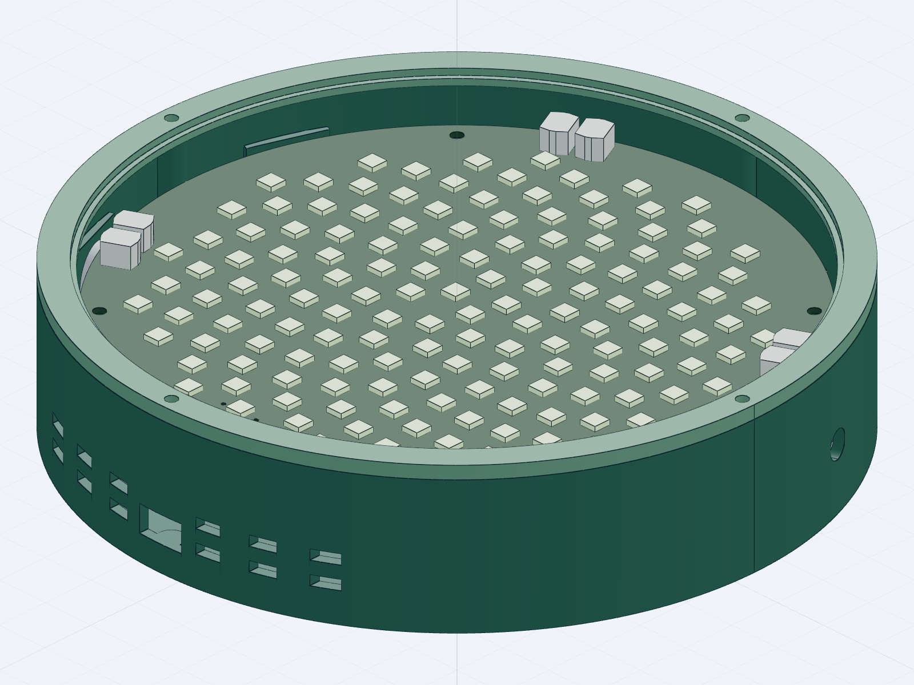

# PHYLLO · 声音生长成光

让声音沿着“向日葵”的黄金角排列变成光。PHYLLO把浏览器音频演示、STM32信号处理、144灯PCB与可拆卸外壳放在同一个工程中，共用一份几何与灯链数据，便于从画面追溯到代码和设计文件。



> 原项目保存的候选结构渲染，不是实板照片；电路、制造、接线、打印配合与实物性能仍待验证。

## 状态与功能

**开发中：采购前数字工程，软件可独立体验，硬件未实测。** 本次开源整理不启动EDA、不改变原设计、不制造或烧录。

- 浏览器演示黄金角阵列、三种空间灯效与配色；支持合成信号及本地音频分析。
- 固件核心实现去直流、Hann窗、512点FFT、RMS、七频段能量和谱通量节拍检测。
- STM32F411候选工程包含I2S DMA、音频队列、灯链映射、WS2812 DMA输出与串口遥测。
- PCB、原理图、可读电路图、参数化机械源与自有打印件模型可审阅。
- 网页设备区只读显示串口状态；浏览器动画不代表实体设备已正常工作。


## 技术栈

| 部分 | 技术与依赖 |
|---|---|
| 网页 | 原生JavaScript、Canvas、Web Audio、Web Serial；Node.js 18+用于本地服务/测试，无npm运行依赖 |
| 可移植核心 | C11、GCC、CMake 3.20+、Ninja、数学库 |
| 板级候选 | STM32F411CEU6、Arm GNU工具链、锁定ST HAL/CMSIS官方来源 |
| 电路 | 嘉立创EDA专业版原工程及KiCad审阅工程，另有PDF阅读图 |
| 结构 | Python参数化源、build123d/cadgen工作流；可直接查看已导出的自有STEP/STL/3MF |

## 快速体验网页

```powershell
git clone https://github.com/yangwei251003/phyllotaxis.git
cd phyllotaxis
node web/server.mjs
```

打开 `http://127.0.0.1:8765/`，默认合成信号即可体验，不需要麦克风或硬件。麦克风需要浏览器授权；音频在本地处理。Web Serial需要支持该API的浏览器和安全上下文，不能笼统承诺所有手机可用。

仓库配置了GitHub Pages静态发布工作流，启用后可从 [在线演示](https://yangwei251003.github.io/phyllotaxis/) 直接体验。网页展示与实体硬件验收是两件事。

## 测试可移植固件核心

需要GCC、CMake与Ninja已在PATH中：

```powershell
cmake -S firmware -B .runtime/host -G Ninja -DCMAKE_C_COMPILER=gcc
cmake --build .runtime/host
ctest --test-dir .runtime/host --output-on-failure
```

网页单元测试与本地HTTP检查：

```powershell
cd web
node --test tests/*.test.mjs
cd ..
python scripts/smoke-web.py
```

## 可选：离线构建F411候选

需要Git、Python 3、CMake、Ninja及 `arm-none-eabi-gcc/objcopy/nm/size` 在PATH：

```powershell
python firmware/bootstrap_sources.py
python firmware/build_candidate.py
```

bootstrap只下载锁定版本的官方源码并检查提交/哈希，遇到本地修改会停止，不重置源码。供应商目录和编译输出已忽略。此命令不连接、枚举、烧录或操作开发板；候选输出不构成烧录放行。真实板型、麦克风槽位、数据时序、供电、温升和灯链需要后续实物核实。

## 设计文件与目录

```text
web/                      网页演示与遥测解析
firmware/include,src,tests 可移植C核心与测试
firmware/platform/        F411候选板级工程
shared/                   网页、PCB和结构共用几何/灯链数据
hardware/eda/             嘉立创原设计源
hardware/prototype-v02/    后续候选KiCad工程、PDF和制造审阅资料
mechanical/               自有参数源及独立零件STEP/STL/3MF
docs/images/              原项目保存的真实界面/渲染图
```

制造目录名称中的REVIEW和NOT-FOR-MANUFACTURE保留原意；未在本次开源整理复跑DRC/ERC或重新核对EDA连接。第三方参考板/麦克风模型及包含它们的完整装配模型未再分发，详见 [来源与排除范围](PROVENANCE.md)。独立零件可直接查看，但不能据数字模型宣称打印配合通过。

## 验证、规划与许可

本次实际执行结果见 [VALIDATION.md](VALIDATION.md)，历史检查不能自动升级为当前实板结论。更新与规划见 [CHANGELOG.md](CHANGELOG.md)。自有部分按 [MIT](LICENSE) 发布；外部依赖及厂商参考的许可边界见 [THIRD_PARTY_NOTICES.md](THIRD_PARTY_NOTICES.md)。
